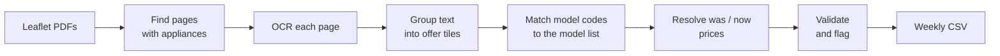

# Leaflet Price Extractor

Retailers publish promotional leaflets every week. Somebody on a pricing team then reads them page by page and types each offer into a spreadsheet. This project does that reading.

Give it a folder of leaflet PDFs and it returns one clean row per offer: retailer, country, week, brand, model, capacity, the old price and the new price.

It is deterministic on purpose. There is no model training and nothing is guessed: a product only counts if its code matches your model list, and anything uncertain is flagged for a person to check instead of being filled in.

## How it works



| Step | File | What it does |
|---|---|---|
| Find pages | `src/prefilter.py` | Skips pages with no appliances, so OCR time goes where it matters |
| OCR | `src/ocr_page.py` | Reads each page and saves the text with its position, so later steps can be re-run without reading again |
| Offer tiles | `src/extract_page.py` | Groups text into the tiles a retailer lays out, using a layout profile per retailer |
| Match | `src/matcher.py` | Matches printed codes to the model list, tolerating common OCR slips such as 0 and O |
| Prices | `src/prices.py` | Works out which number is the old price and which is the promo price, and checks them against any printed discount |
| Validate | `src/validate.py` | Flags rows that are missing a price or look wrong |
| Output | `src/output_writer.py` | Writes the CSV in the agreed column order ([docs/OUTPUT_SPEC.md](docs/OUTPUT_SPEC.md)) |

Everything about a leaflet comes from its file name: `COUNTRY_RETAILER_WXX.pdf` gives the country (so the currency and decimals), the retailer (so the layout profile) and the week.

## Run it

```bash
python -m venv .venv
./.venv/bin/pip install -r requirements.txt

# 1. Add your model list as data/master/Model List.xlsx (or .csv), then build the clean master
./.venv/bin/python src/build_master.py

# 2. Drop leaflets into their week folder, e.g. data/leaflets/2026-w30/UAE_RETAILER_W30.pdf

# 3. Run the batch. It is crash-safe: stop it any time and run again to continue
./.venv/bin/python src/run_batch.py --year 2026

# 4. Collect the result
open output/Leaflet_Extraction_2026-W30.csv
```

Or use the point-and-click app:

```bash
./.venv/bin/streamlit run app.py
```

Upload leaflets, run, review the results in three tabs, and inspect the OCR audit images to see exactly what was read.

## What you need to bring

- **Leaflets** as PDFs. They are public marketing material, but bulky, so they are not kept in this repository.
- **A model list**: the model codes you care about, with brand and category. The repository ships without one.
- **Layout profiles** for your retailers live in `data/master/layout_profiles.json`. Each retailer arranges its tiles differently, so each gets its own profile.

## What it does not do

- It reads refrigerators and washing machines. Other categories need their own matching rules.
- It does not read a product whose code is not in your model list. That is the design: no match, no row.
- Scanned leaflets with very small print need a higher OCR zoom, set per retailer in the layout profile.

## Built with

Python, PaddleOCR, PyMuPDF, pandas and Streamlit, with a Dockerfile for running the app in a container.

## Where it came from

I built the first version for a consumer electronics pricing team that tracked competitor promotions by hand across several Gulf markets. This is the general version, with the company's data and internal tooling removed.
